# Taverna

Mesa virtual para jogar RPG de mesa online com os amigos. O mestre cria a campanha, manda um link de convite e o grupo joga junto em tempo real, cada um de onde estiver. Começa pelo **D&D 5ª edição**, mas foi pensada para receber outros sistemas.

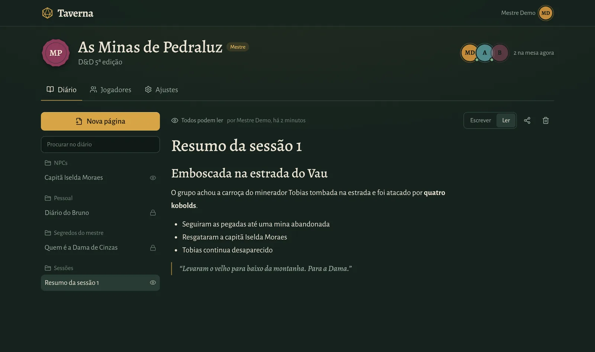

## O que já dá para fazer

- **Contas** com cadastro, login e sessão em cookie httpOnly. Cada pessoa escolhe o nome e a cor com que aparece na mesa.
- **Campanhas**: quem cria vira mestre. A lista mostra as mesas que você mestra e as que você joga.
- **Convite por link**: o mestre copia o link e quem abrir entra como jogador. Dá para gerar outro link (o antigo para de funcionar) ou desativar o convite.
- **Papéis**: mestre, co-mestre e jogador. O mestre promove e remove participantes, o co-mestre ajuda a organizar e qualquer jogador pode sair.
- **Diário** em Markdown, com pastas e busca. Cada página tem permissão própria: secreta, todos leem ou todos editam, e exceções por jogador. O autor e os mestres sempre podem tudo.
- **Dados**: rolador com a notação completa (vantagem, manter e descartar, explosão, rerrolar e contas), montado pelos botões ou escrito à mão, com faixa e média antes de rolar. Quem rola escolhe se todos veem, só os mestres ou só ela. O servidor rola, para ninguém trapacear, e a mesa vê o resultado na hora.
- **Fichas de D&D 5e**: atributos, salvaguardas e perícias com especialização e pau para toda obra, PV e PV temporário, testes contra a morte, dados de vida, descanso curto e longo, ataques com dano e crítico, magias com espaços por círculo, pacto e concentração, e contadores de classe (Ki, Fúria, Dados de Superioridade, Inspiração Bárdica, Pontos de Feitiçaria) ou livres. Tudo que tem número rola com um clique, com vantagem ou desvantagem, e a ficha se salva sozinha. O dono e os mestres editam; o resto do grupo vê, a não ser que o dono esconda.
- **Compêndio**: as 1.155 entradas do SRD 5.1 (319 magias, 334 monstros, 476 itens, condições, raças, talento e antecedente), com busca e filtros por círculo, escola, classe, tipo de criatura, nível de desafio, categoria e raridade. Os monstros abrem numa ficha de pergaminho em que ataque, dano, PV e atributos rolam com um clique, e as rolagens do mestre ficam secretas. O mestre cria homebrew de magias, itens, monstros, condições e talentos, do zero ou copiando uma entrada do SRD, e publica quando quiser. Magias e armas vão para a ficha arrastando ou pelo botão de adicionar.
- **Mesa virtual**: cenas com mapa, grade e tokens, e uma de cada vez aberta para os jogadores, trocada com um clique. O mestre arrasta o mapa do computador para a mesa ou escolhe na galeria (JPG, PNG, WebP, GIF, SVG, WebM e MP4, até 25 MB), coloca várias imagens na mesma cena ou começa do zero com cor ou textura de fundo. O mapa se ajusta pelos cantos (Shift mantém a proporção), gira, espelha, trava e encaixa num tamanho em quadrados, como 30 × 20, ou na grade desenhada na própria imagem. Grade quadrada, hexagonal ou nenhuma, com escala por quadrado em metros ou pés. Pincel, retângulo, elipse, linha, texto e marcadores, régua que conta quadrados e distância, e moldes de área de cone, esfera, linha, cilindro e cubo. Quatro camadas (mapa, objetos, tokens e a do mestre, que os jogadores não recebem) e tudo aparece para o grupo na hora.
- **Motor de regras do 5e**: modificadores, proficiência com especialização e pau para toda obra, espaços de magia com multiclasse e pacto, CD de magia, crítico, testes contra a morte e pontos de vida, cada fórmula com teste automatizado.
- **Tempo real**: quem está na mesa agora, páginas que aparecem para os outros assim que são salvas, e o jogador removido sai da tela na hora.

| Entrar                      | Primeiros passos do mestre          |
| --------------------------- | ----------------------------------- |
| 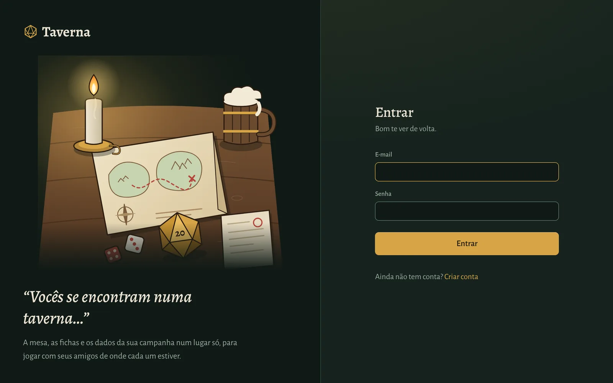 | 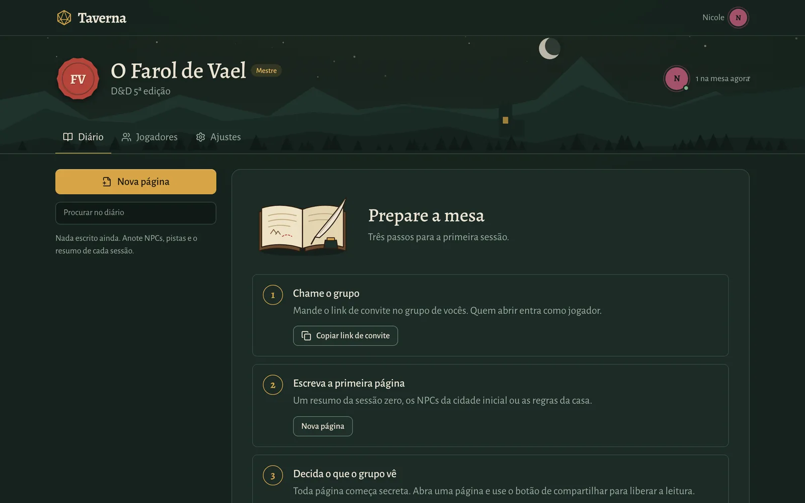 |

| Jogadores e convite               | Quem vê cada página                 |
| --------------------------------- | ----------------------------------- |
| 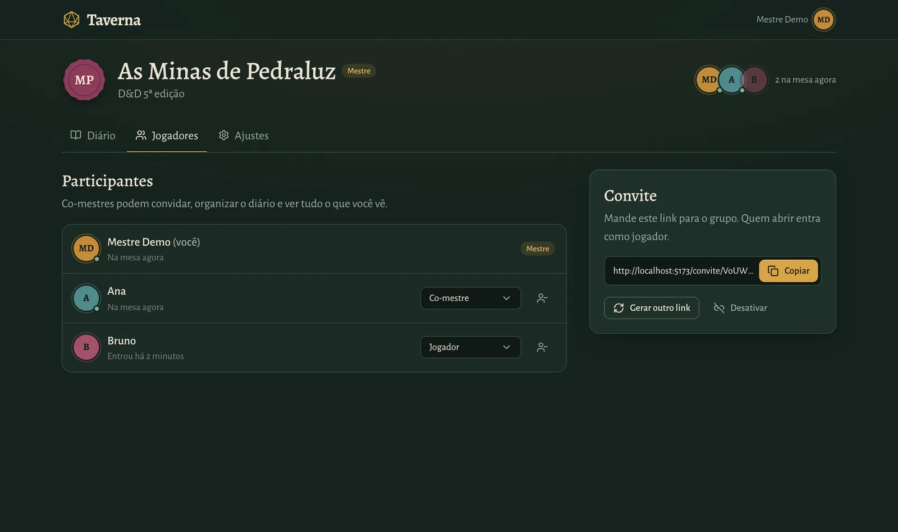 | 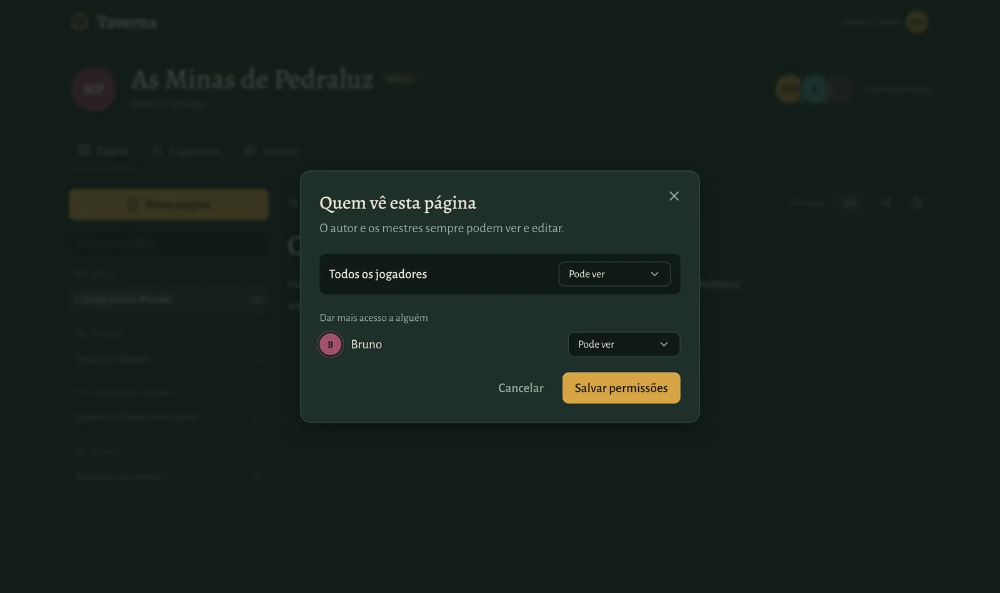 |

| Convite                       | Suas mesas                     |
| ----------------------------- | ------------------------------ |
| 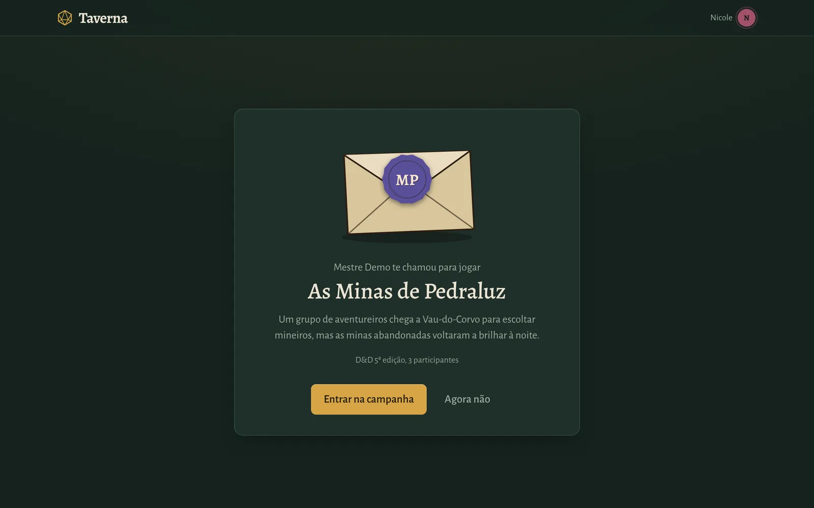 | 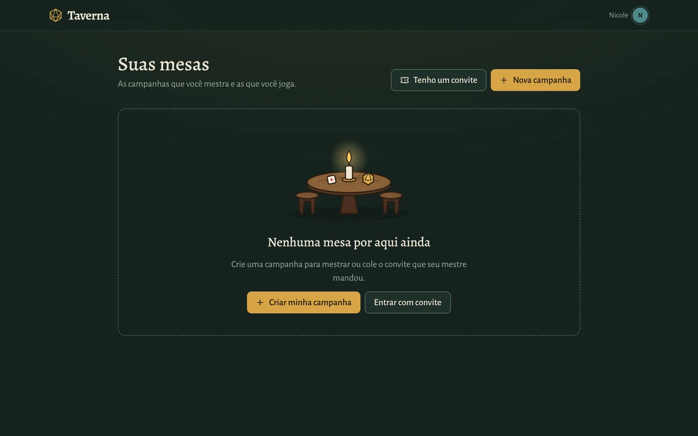 |

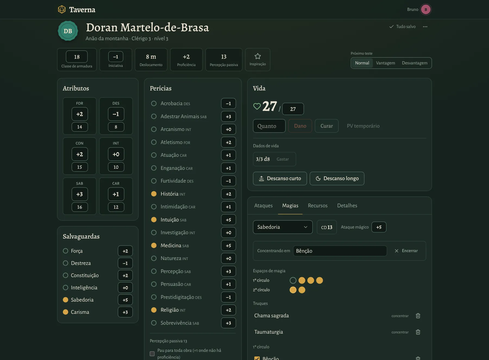

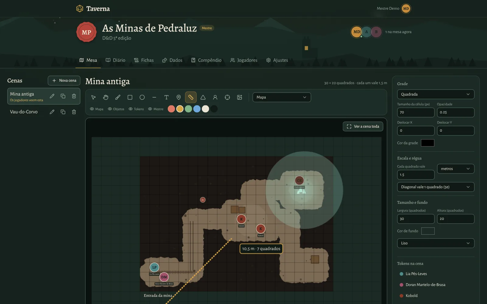

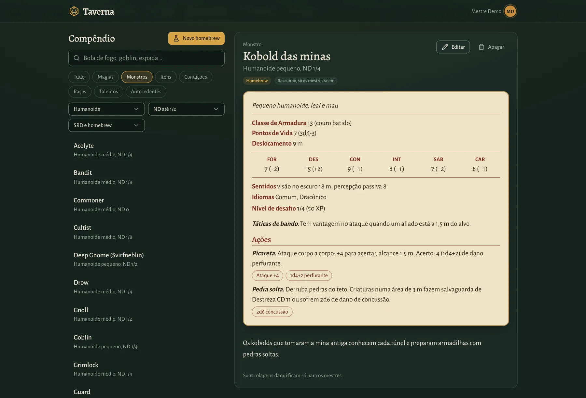

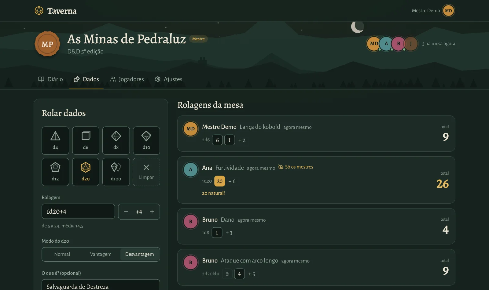

<p align="center">
  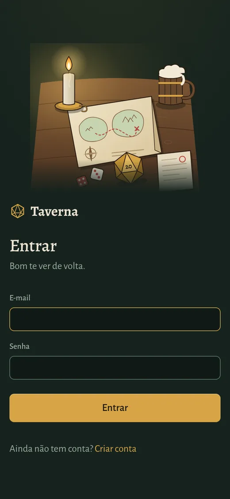
  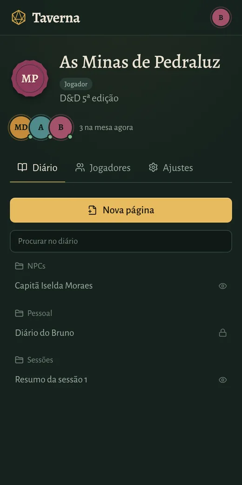
  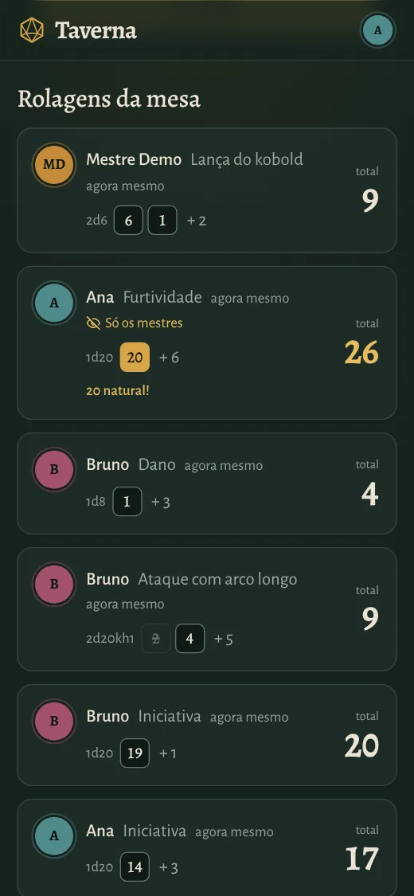
  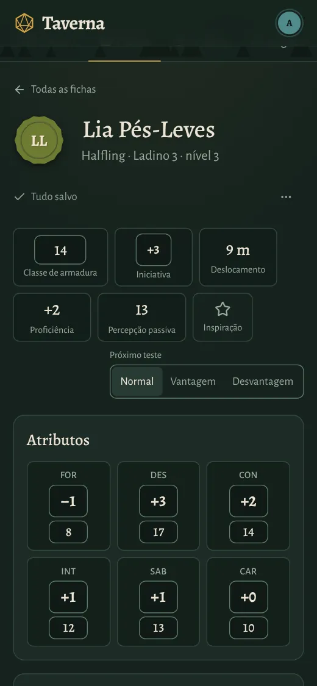
  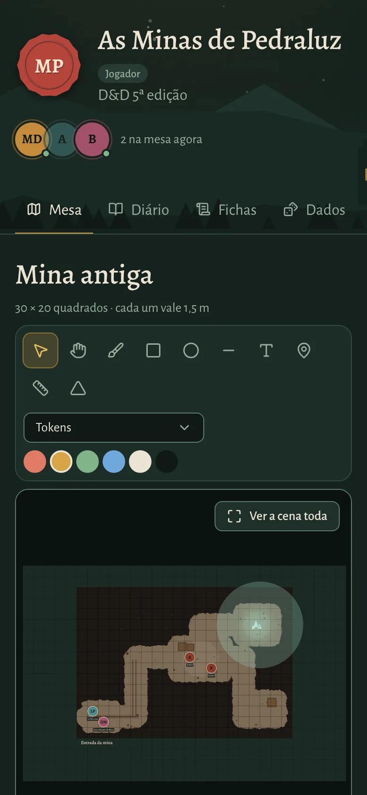
</p>

## Design e acessibilidade

- **Identidade própria:** feltro verde de mesa de jogo, latão dos dados e papel cor de osso, com a família Alegreya. Cada campanha ganha um selo de lacre com as iniciais e uma paisagem gerada a partir dela no cabeçalho.
- **Ilustrações próprias em SVG**, feitas para o projeto: a mesa da taverna no login, a mesa vazia, o livro do diário, a carta com lacre do convite (e o lacre partido quando o convite não vale mais) e o d20 tirando 1 nas telas de erro.
- **Pensado para quem chega pelo celular:** o convite abre direto no telefone, cria a conta e volta sozinho para a campanha.
- **Primeiros passos do mestre:** depois de criar a campanha, um painel guia os três passos até a primeira sessão e marca cada um quando é feito.
- **WCAG 2.1 AA:** contraste conferido em todos os tokens, link para pular o cabeçalho, foco que volta para quem abriu cada diálogo, alvos de 44 px em telas de toque e nomes acessíveis nos avatares e ícones. O teste `acessibilidade.spec.ts` roda o **axe** em 8 telas e falha se aparecer qualquer violação.

## Stack

| Camada        | Tecnologias                                                                                                                                                         |
| ------------- | ------------------------------------------------------------------------------------------------------------------------------------------------------------------- |
| Front-end     | React 19, TypeScript, Vite, Tailwind CSS 4, React Router, TanStack Query, React Hook Form, Zod, Radix UI                                                            |
| Back-end      | NestJS 11, Drizzle ORM, PostgreSQL, Socket.IO, JWT em cookie httpOnly, Helmet, rate limit, logs com Pino                                                            |
| Compartilhado | Pacote `@taverna/shared` com schemas Zod, tipos e eventos do WebSocket usados pela API e pelo front                                                                 |
| Testes        | Jest e Supertest com banco real na API, Vitest e Testing Library no front, Playwright com dois navegadores (mestre e jogador) e auditoria de acessibilidade com axe |
| Entrega       | Docker multi-stage, Docker Compose, GitHub Actions                                                                                                                  |

## Arquitetura

```
taverna/
├── packages/
│   ├── dice/            parser e rolador da notação de dados, com mínimo, máximo e média
│   ├── rules-core/      interface do motor de regras, que não conhece nenhum sistema
│   ├── rules-5e/        regras do D&D 5e
│   ├── tabletop/        geometria da mesa: grade quadrada e hexagonal, régua, moldes de área e encaixe de mapas
│   └── shared/          schemas, tipos, papéis, permissões e eventos do tempo real
├── api/                 NestJS
│   ├── drizzle/         migrations SQL
│   ├── src/
│   │   ├── common/      guard de sessão, validação com Zod, pipes
│   │   ├── config/      validação das variáveis de ambiente
│   │   ├── database/    schema do Drizzle, migrate e seed
│   │   └── modules/
│   │       ├── auth/        cadastro, login e perfil
│   │       ├── campaigns/   campanhas, convites, papéis e acesso
│   │       ├── journals/    diário com permissões
│   │       ├── realtime/    gateway Socket.IO, salas e presença
│   │       ├── characters/  fichas com permissão e versão
│   │       ├── compendium/  busca no SRD e homebrew da campanha
│   │       ├── rolls/       rolagens feitas no servidor
│   │       ├── assets/      mapas e vídeos enviados, guardados no banco
│   │       ├── scenes/      cenas, camadas e itens da mesa
│   │       └── health/
│   └── test/            testes de integração com PostgreSQL
└── web/                 React
    ├── src/
    │   ├── app/         rotas, layout, guards
    │   ├── components/  design system e ilustrações em SVG
    │   ├── features/    uma pasta por tela
    │   └── lib/         cliente HTTP, socket, markdown
    └── e2e/             Playwright
```

A regra de permissão vive em `packages/shared`, então a API e o front usam a mesma função para decidir quem vê e quem edita. Na API, toda rota de campanha passa pelo `CampaignAccessService`, e quem não participa recebe 404 em vez de 403, para não revelar que a campanha existe.

O tempo real usa uma sala do Socket.IO por campanha. A conexão se autentica pelo mesmo cookie da API, e entrar na sala exige ser participante. Depois de cada alteração, os serviços avisam a sala e o front só invalida a consulta certa no TanStack Query.

## Notação de dados

| Escreva              | O que faz                                                       |
| -------------------- | --------------------------------------------------------------- |
| `1d20+5`             | Um d20 mais 5                                                   |
| `2d20kh1`            | Vantagem: rola dois e fica com o maior (`kl1` fica com o menor) |
| `4d6dl1`             | Rola quatro e descarta o menor (`dh` descarta o maior)          |
| `2d6r2`              | Rerrola uma vez os resultados até 2                             |
| `3d6!`               | Explode: cada 6 rola mais um dado                               |
| `d%`                 | O mesmo que `1d100`                                             |
| `(1d8+3)*2`          | Contas com parênteses, `*` e `/` (arredonda para baixo)         |
| `8d6 # Bola de fogo` | O que vem depois do `#` vira o rótulo                           |

A ficha se salva sozinha um instante depois de cada mudança. Cada gravação leva o número da versão que a tela tinha; se o mestre e a jogadora editarem ao mesmo tempo, a segunda gravação volta com 409 e a tela carrega a versão nova em vez de apagar o que a outra pessoa fez.

O `packages/dice` não sabe nada de D&D. As regras ficam no `packages/rules-5e`, que se registra no `rules-core` pelo id `dnd5e`. Por isso outro sistema entra como um pacote novo, sem mexer no rolador nem nas telas.

## Mesa virtual

A mesa desenha com [Konva](https://konvajs.org). Cada item da cena (imagem, vídeo, desenho, forma, texto, marcador, token ou molde) é uma linha com posição, tamanho, giro, espelho, trava, ordem e camada, e os dados de cada tipo vão num campo JSON. As contas de grade, régua e moldes ficam em `packages/tabletop`, sem dependência de tela, e têm testes próprios. A régua segue a regra do 5e, em que a diagonal vale um quadrado, e a cena pode trocar para a regra alternada (5-10-5).

Os jogadores só recebem a cena aberta, e nunca os itens da camada do mestre: a API filtra antes de responder e o tempo real manda esses itens só para os mestres. Jogadores podem desenhar, escrever, marcar e medir nas camadas de objetos e tokens, e mexer no que eles mesmos colocaram ou no token que é deles.

Os arquivos enviados ficam no PostgreSQL, então não é preciso configurar armazenamento à parte. O tipo do arquivo é conferido pelos primeiros bytes, não pela extensão, e SVG é servido com uma política de segurança que bloqueia scripts.

## Compêndio e SRD 5.1

O SRD vem do projeto aberto [5e-database](https://github.com/5e-bits/5e-database). O script `api/scripts/build-srd.mjs` converte os arquivos dele para o formato da Taverna e gera `api/srd/srd-5.1.json.gz`, que a migração importa sozinha (`npm run db:migrate`). Rodar de novo atualiza as entradas sem duplicar.

Condições, raças, talento e antecedente usam a tradução em português do próprio 5e-database. Magias, monstros e itens ainda estão com o texto original em inglês, com os nomes de escola, tipo de criatura, categoria e dano traduzidos; a interface avisa quando o texto é em inglês. Quem quiser a versão em português de uma entrada pode copiá-la para homebrew e traduzir.

Este trabalho inclui material do System Reference Document 5.1 (SRD 5.1) da Wizards of the Coast LLC, disponível em https://dnd.wizards.com/resources/systems-reference-document. O SRD 5.1 está licenciado sob a [Creative Commons Atribuição 4.0 Internacional](https://creativecommons.org/licenses/by/4.0/legalcode).

## Como rodar

Requisitos: **Node 20+** e **Docker Desktop** aberto.

```bash
npm install
cp api/.env.example api/.env
npm run db:up
npm run db:migrate
npm run db:seed
npm run dev
```

No PowerShell, troque o `cp` por `copy api\.env.example api\.env`.

Abra http://localhost:5173. O seed cria a campanha **As Minas de Pedraluz** com três contas, todas com a senha `taverna123`:

| Conta              | Papel     |
| ------------------ | --------- |
| mestre@taverna.dev | Mestre    |
| ana@taverna.dev    | Co-mestre |
| bruno@taverna.dev  | Jogador   |

Para ver o tempo real, entre com duas contas em janelas diferentes (uma delas anônima).

## Testes

```bash
npm test                    # unitários dos pacotes, da API e do front
npm run test:e2e -w api     # integração da API com PostgreSQL
npm run test:e2e -w web     # Playwright: mestre e jogador ao mesmo tempo, e acessibilidade com axe
npm run lint
npm run typecheck
```

Os testes de integração usam o banco `taverna_test`, criado automaticamente pelo `docker-compose`.

## API

Todas as rotas ficam em `/api` e, menos cadastro, login e saúde, exigem a sessão.

| Método             | Rota                                            | Descrição                        |
| ------------------ | ----------------------------------------------- | -------------------------------- |
| POST               | `/auth/register`, `/auth/login`, `/auth/logout` | Sessão                           |
| GET, PATCH         | `/auth/me`                                      | Perfil                           |
| GET, POST          | `/campaigns`                                    | Suas campanhas e criar           |
| GET, PATCH, DELETE | `/campaigns/:id`                                | Detalhes, editar e apagar        |
| POST, DELETE       | `/campaigns/:id/invite`                         | Gerar ou desativar o link        |
| GET                | `/invites/:code`                                | Prévia do convite                |
| POST               | `/invites/:code/accept`                         | Entrar na campanha               |
| GET                | `/campaigns/:id/members`                        | Participantes                    |
| PATCH, DELETE      | `/campaigns/:id/members/:userId`                | Mudar papel e remover            |
| GET, POST          | `/campaigns/:id/journals`                       | Páginas visíveis e criar         |
| GET, PATCH, DELETE | `/campaigns/:id/journals/:pageId`               | Ler, editar, permissões e apagar |
| GET, POST          | `/campaigns/:id/characters`                     | Fichas visíveis e criar          |
| GET, PATCH, DELETE | `/campaigns/:id/characters/:characterId`        | Ler, editar, permissões e apagar |
| GET, POST          | `/campaigns/:id/compendium`                     | Buscar e criar homebrew          |
| GET, PATCH, DELETE | `/campaigns/:id/compendium/:entryId`            | Ler, editar e apagar homebrew    |
| GET, POST          | `/campaigns/:id/rolls`                          | Rolagens visíveis e rolar        |
| GET, POST          | `/campaigns/:id/assets`                         | Galeria e envio de arquivo       |
| DELETE             | `/campaigns/:id/assets/:assetId`                | Apagar da galeria                |
| GET                | `/assets/:assetId`                              | Baixar o arquivo                 |
| GET, POST          | `/campaigns/:id/scenes`                         | Cenas e criar                    |
| GET                | `/campaigns/:id/scenes/active`                  | Cena aberta para os jogadores    |
| GET, PATCH, DELETE | `/campaigns/:id/scenes/:sceneId`                | Ler, configurar e apagar         |
| POST               | `/campaigns/:id/scenes/:sceneId/activate`       | Mostrar aos jogadores            |
| POST               | `/campaigns/:id/scenes/:sceneId/duplicate`      | Duplicar                         |
| POST               | `/campaigns/:id/scenes/:sceneId/items`          | Colocar item                     |
| PATCH, DELETE      | `/campaigns/:id/scenes/:sceneId/items/:itemId`  | Mover, ajustar e apagar item     |
| GET                | `/health`                                       | Saúde da API e do banco          |

| Evento (Socket.IO)                 | Direção            | O que faz                                      |
| ---------------------------------- | ------------------ | ---------------------------------------------- |
| `campaign:join`, `campaign:leave`  | cliente → servidor | Entrar e sair da sala da campanha              |
| `presence:list`                    | servidor → cliente | Quem está na mesa agora                        |
| `campaign:changed`                 | servidor → cliente | Algo mudou (participantes, diário ou campanha) |
| `campaign:removed`                 | servidor → cliente | Você saiu ou foi removido                      |
| `roll:new`                         | servidor → cliente | Rolagem nova, só para quem pode ver            |
| `scene:list`, `scene:active`       | servidor → cliente | Cenas mudaram ou outra foi aberta              |
| `scene:item`, `scene:item:removed` | servidor → cliente | Item colocado, mexido ou apagado               |

## Deploy

Em produção a API também entrega o front, então é um serviço só, e as migrations rodam sozinhas ao iniciar:

```bash
docker compose --profile app up --build
```

Variáveis: `DATABASE_URL`, `JWT_SECRET`, `WEB_ORIGIN` e `PORT`.
